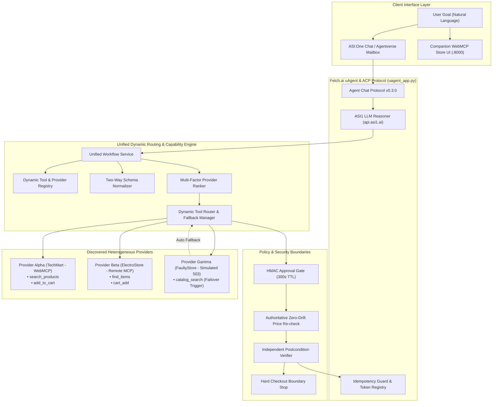

# Dynamic WebMCP Agent Network
### Autonomous Multi-Agent Web Operator using WebMCP + Fetch.ai ACP + ASI:One
**Built for Fetch-A-Thon 3.0 by Fetch.ai Innovation Lab**

> *"From brittle screen clicks and DOM scrapers to structured, dynamic tool networks."*

---

## 1. Executive Summary & Core Innovation

Traditional web AI agents rely on computer-use approaches: capturing screenshots, guessing CSS selectors, and clicking coordinates. When website layouts or DOM classes change, these agents instantly break.

**Dynamic WebMCP Agent Network** pioneers a future-proof architecture for autonomous web operations:
- **Runtime Tool Discovery**: Discovers structured website tools through **WebMCP** (`window.modelContext` / `navigator.modelContext`) and **Remote MCP** servers on-the-fly without hardcoding.
- **Canonical Capability Layer**: Dynamically maps heterogeneous tools into unified primitives (`PRODUCT_SEARCH`, `PRODUCT_DETAILS`, `CART_ADD`, `CART_READ`), seamlessly normalizing divergent schemas (e.g., TechMart's `search_products(query, max_price)` vs ElectroStore's `find_items(keywords, budget)`).
- **Multi-Factor Provider Ranking**: Evaluates candidates across schema compatibility ($S_{\text{match}}$), data quality ($S_{\text{quality}}$), health reliability ($S_{\text{reliability}}$), spec freshness ($S_{\text{freshness}}$), and latency penalties ($P_{\text{latency}}$).
- **Automatic Fallover & Resilience**: Instantly intercepts provider degradation or errors (e.g. simulated 503) and re-routes to the next best provider without user disruption.
- **Strict Human Approval Gate**: Cryptographically binds state-changing operations with HMAC-SHA256 tokens, enforcing zero-tolerance price drift checks before mutation.
- **Independent Postcondition Verification**: Verifies actions independently via `CART_READ` queries rather than blindly trusting return codes, strictly halting before checkout or payment.
- **Dual-Mode Operation**:
  1. **Primary Conversational Agent**: Real Fetch.ai `uAgent` using official **Agent Chat Protocol (ACP v0.3.0)** discoverable on **ASI:One** with native Interactive Cards. No browser required.
  2. **Companion WebMCP Store**: Interactive web store (`apps/demo-store`) demonstrating client-side WebMCP registration, tunneling, and visual reactive trace.

---

## 2. Agent Identity & Specifications

| Attribute | Specification |
| :--- | :--- |
| **Agent Name** | `dynamic_webmcp_operator` |
| **Protocol** | Agent Chat Protocol (ACP) v0.3.0 (`uagents_core.contrib.protocols.chat`) |
| **Framework** | Fetch.ai `uagents` SDK (v0.26.1) |
| **Agentverse Discovery** | Managed Mailbox (`USE_AGENTVERSE=true`) |
| **ASI:One UI** | Predefined Interactive Cards (`review_card`, `carousel_card`) + Text Markdown |
| **Default Model Engine** | ASI1 LLM (`api.asi1.ai`) with robust deterministic fallback |
| **Test Coverage** | 25 Unit Tests (100% pass) + 4-turn E2E Chat Simulation |

---

## 3. System Architecture



---

## 4. Multi-Agent Specialist Roles

The architecture organizes operational responsibilities across discrete specialist agents:

| Agent | Responsibility | Implementation File |
| :--- | :--- | :--- |
| **`dispatcher_agent`** | Primary gateway handling ACP messages, session lifecycle, and acknowledgements. | [`backend/uagent_app.py`](file:///Users/tusharsingh/.gemini/antigravity/scratch/dynamic-webmcp-agent-network/backend/uagent_app.py) |
| **`planner_agent`** | Deconstructs user queries into structured constraints (budget, category, priorities). | [`backend/llm/asi1_client.py`](file:///Users/tusharsingh/.gemini/antigravity/scratch/dynamic-webmcp-agent-network/backend/llm/asi1_client.py) |
| **`discovery_agent`** | Discovers tools exposed dynamically on active browser tabs or MCP server handshakes. | [`backend/registry/tool_registry.py`](file:///Users/tusharsingh/.gemini/antigravity/scratch/dynamic-webmcp-agent-network/backend/registry/tool_registry.py) |
| **`routing_agent`** | Evaluates provider fitness, computes ranking scores, and executes parallel queries. | [`backend/routing/tool_router.py`](file:///Users/tusharsingh/.gemini/antigravity/scratch/dynamic-webmcp-agent-network/backend/routing/tool_router.py) |
| **`comparison_agent`** | Synthesizes candidate specs into multi-attribute decision matrices and trade-off rationales. | [`backend/services/workflow_service.py`](file:///Users/tusharsingh/.gemini/antigravity/scratch/dynamic-webmcp-agent-network/backend/services/workflow_service.py) |
| **`policy_agent`** | Human-in-the-loop gate; binds approval tokens to target SKU, price, and requesting sender. | [`backend/agents/policy_agent.py`](file:///Users/tusharsingh/.gemini/antigravity/scratch/dynamic-webmcp-agent-network/backend/agents/policy_agent.py) |
| **`cart_agent`** | Executes approved tool invocations through the provider adapter. | [`backend/agents/cart_agent.py`](file:///Users/tusharsingh/.gemini/antigravity/scratch/dynamic-webmcp-agent-network/backend/agents/cart_agent.py) |
| **`postcondition_verifier`** | Queries `CART_READ` independently to confirm real database state change. | [`backend/agents/cart_agent.py`](file:///Users/tusharsingh/.gemini/antigravity/scratch/dynamic-webmcp-agent-network/backend/agents/cart_agent.py) |
| **`audit_agent`** | Maintains structured immutable audit trails redacting credentials. | [`backend/agents/audit_agent.py`](file:///Users/tusharsingh/.gemini/antigravity/scratch/dynamic-webmcp-agent-network/backend/agents/audit_agent.py) |

> **Bonus Multi-Agent Bureau**: For native inter-agent message passing using `uagents.Bureau` and `uagents.Model`, see [`backend/bureau_network.py`](file:///Users/tusharsingh/.gemini/antigravity/scratch/dynamic-webmcp-agent-network/backend/bureau_network.py) (`python scripts/test_bureau.py`).

---

## 5. Provider Ranking & Multi-Factor Scoring

When a canonical capability is requested, providers are scored using normalized multi-factor weights:

$$\text{Score} = 0.35 \cdot S_{\text{match}} + 0.25 \cdot S_{\text{quality}} + 0.20 \cdot S_{\text{reliability}} + 0.10 \cdot S_{\text{freshness}} - 0.10 \cdot P_{\text{latency}}$$

- **Hard Constraints**: Filtered *before* scoring (e.g. providers missing required capabilities, or with unreachable health, are immediately excluded).
- **Automatic Fallover**: If Provider Gamma fails (503 Service Unavailable), the router intercepts the failure, logs the incident, and transparently executes on Provider Alpha.

---

## 6. Security & Policy Enforcement

1. **Exact Origin Allowlist**: Prevents DNS rebinding and phishing (e.g., `evil-localhost.com:8000` is strictly rejected; only exact hosts like `localhost:8000`, `127.0.0.1:8000`, `asi1.ai` are authorized).
2. **Zero-Tolerance Price Drift**: Immediately prior to cart execution, the agent issues an authoritative `PRODUCT_DETAILS` fetch. If the live catalog price diverges from the bound approval price, execution is halted, the token is invalidated, and the user is alerted.
3. **Sender Address Binding**: Tokens are bound to the cryptographic Bech32 address (`agent1q...`) of the requester. An execution request from an unauthorized address is rejected with `PermissionError`.
4. **Idempotency Guard**: Prevents replay attacks and duplicate orders when network packets are retransmitted.
5. **Checkout Boundary**: Execution strictly terminates after cart item verification. The agent will never initiate payment or finalize orders autonomously.

---

## 7. Quickstart & Verified Commands

### Prerequisites
- Python 3.10+ (tested on Python 3.11.17)
- Virtual environment (`.venv`)

### 1. Environment Setup
```bash
make setup
```
*(Creates `.venv` and installs `uagents`, `uagents-core`, `openai`, `pydantic`, `python-dotenv`, `requests`, `cosmpy`)*

### 2. Verify System Configuration
```bash
make verify
```
*Expected Output:*
```text
=============================================================
   Dynamic WebMCP Agent Network — Environment Verification   
=============================================================
[✓] Python Runtime: 3.11.17
[✓] Active Providers Registered: 3
    • TechMart Online (provider_alpha) - Health: healthy - Quality: 0.96
    • ElectroStore Pro (provider_beta) - Health: healthy - Quality: 0.92
    • FaultyStore Global (provider_gamma) - Health: degraded - Quality: 0.4
[✓] Tools Discovered in Canonical Registry: 9
[✓] Agent Chat Protocol (ACP): AgentChatProtocol v0.3.0
[✓] Router Parallel Search Output: 8 products discovered across providers
=============================================================
   All components VERIFIED and operating normally!           
=============================================================
```

### 3. Run Automated Unit & Regression Tests (25 tests)
```bash
make test
```
*Expected Output:*
```text
Ran 25 tests in 0.013s. OK
```

### 4. Run End-to-End ASI:One Chat Simulation
```bash
make e2e
```
*Expected Output:*
```text
=============================================================
  ASI:One E2E Chat Simulation Test (Agent Chat Protocol v0.3)
=============================================================
[Step 1] User opens conversation in ASI:One (StartSessionContent)...
  ✓ Agent returned acknowledgement
  ✓ Agent sent greeting
[Step 2] User sends shopping goal...
  ✓ Received product comparison matrix & trade-offs
  ✓ Extracted approval token: appr_xxxx
[Step 3] User replies 'APPROVE appr_xxxx'...
  ✓ Action Authorized and Verified! Independent postcondition confirmed
[Step 4] Testing duplicate approval replay attack...
  ✓ Idempotency guard safely intercepted duplicate replay!
=============================================================
  E2E SIMULATION PASSED: 100% SUCCESSFUL CONVERSATION FLOW   
=============================================================
```

### 5. Launch the Fetch.ai uAgent (Primary Conversational Interface)
```bash
make agent
```
*(Runs the real uAgent listening for Agentverse Mailbox connections and ASI:One messages)*

### 6. Launch Companion Demo Store (WebMCP Browser Interface)
```bash
make web
```
Open your browser to:
👉 **`http://localhost:8000`**

---

## 8. Repository Structure

```text
dynamic-webmcp-agent-network/
├── Makefile                        # Verified make targets (setup, test, agent, web, e2e, verify)
├── requirements.txt                # Pinned production dependencies
├── pyproject.toml                  # Project packaging specifications
├── .env.example                    # Template environment variables (no secrets committed)
├── backend/
│   ├── uagent_app.py               # Real Fetch.ai uAgent with ACP v0.3.0 & Mailbox integration
│   ├── cards.py                    # Predefined Agentverse Interactive Cards (review_card, carousel_card)
│   ├── bureau_network.py           # Multi-agent Bureau architecture exchanging typed Model messages
│   ├── app.py                      # Unified HTTP server & WebMCP bridge listener
│   ├── llm/
│   │   └── asi1_client.py          # ASI1 LLM client (api.asi1.ai) with deterministic fallback
│   ├── services/
│   │   ├── workflow_service.py     # Single source of truth for planning, search, ranking & approval
│   │   └── payment_service.py      # Simulated Payment Protocol rail (for procurement dossiers)
│   ├── registry/
│   │   ├── capability_map.py       # Canonical capabilities (PRODUCT_SEARCH, CART_ADD, etc.)
│   │   ├── schema_normalizer.py    # Two-way translation between canonical and provider schemas
│   │   └── tool_registry.py        # Dynamic tool index and TTL capability cache
│   ├── routing/
│   │   ├── provider_ranker.py      # Multi-factor provider scoring algorithm
│   │   ├── fallback_manager.py     # Automatic failover upon provider failure
│   │   └── tool_router.py          # Master dynamic tool router
│   ├── bridge/
│   │   ├── browser_bridge.py       # Active browser session tunnel
│   │   └── bridge_security.py      # Origin allowlist & prompt-injection sanitization
│   ├── agents/
│   │   ├── policy_agent.py         # HMAC-SHA256 human approval gate
│   │   ├── cart_agent.py           # Cart action execution & postcondition verification
│   │   └── audit_agent.py          # Verifiable execution trace audit log
│   └── tests/
│       ├── run_tests.py            # Master test discoverer & runner (25 tests)
│       └── test_workflow_and_regressions.py # Budget, origin, price drift, and replay tests
├── apps/
│   └── demo-store/                 # Companion WebMCP storefront with window.modelContext polyfill
├── docs/
│   ├── JUDGING_CRITERIA_CHECKLIST.md # Honest criteria audit (Done / Partial / Simulated)
│   ├── ACP_AGENTVERSE_SETUP.md     # Mailbox registration & ASI:One discovery guide
│   ├── DEMO_SCRIPT.md              # 3-5 minute presentation script
│   └── DEVPOST.md                  # Complete hackathon submission summary
└── scripts/
    ├── gen_seed.py                 # Cryptographic 24-word seed phrase generator
    ├── e2e_chat_simulation.py      # 4-turn ASI:One conversation test suite
    ├── verify_setup.py             # System verification script
    └── test_bureau.py              # Bureau multi-agent network verification
```

---

## 9. License

Released under the **MIT License**.
Built with ❤️ for **Fetch-A-Thon 3.0 by Fetch.ai Innovation Lab**.
